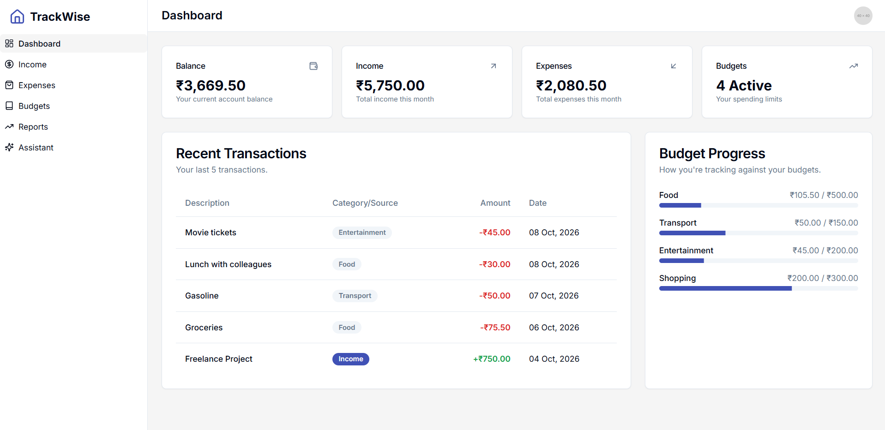
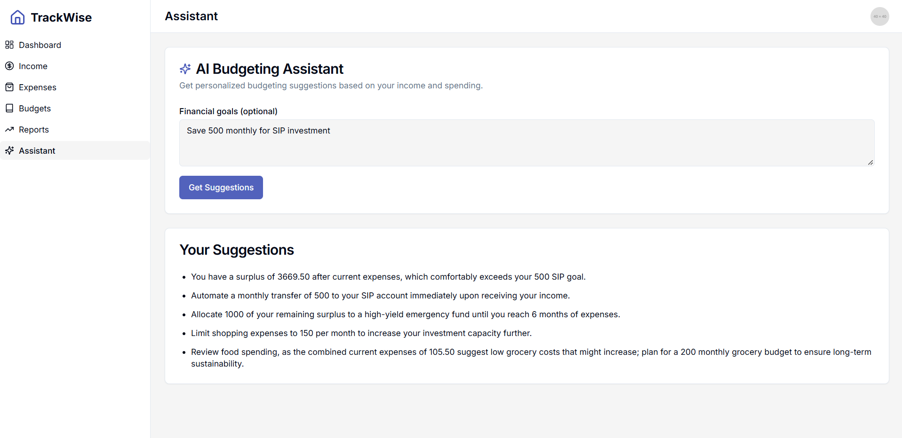

# TrackWise — Personal Finance Tracker with AI Budgeting

A personal finance web app for tracking income, expenses, and budgets, with an AI-powered budgeting assistant that analyzes your spending and suggests ways to hit your financial goals.

**Live demo:** https://track-wise-5j7x.vercel.app/

## Features

- Track income and expenses by category
- Set budgets per category and monitor spending against them
- Visual reports and a dashboard summarizing your finances
- AI Budgeting Assistant: get personalized suggestions based on your income, expenses, and stated financial goals, powered by Google's Gemini model via Genkit
- Data persists locally in the browser, so your entries survive navigation and page refreshes

## Tech Stack

**Frontend:** Next.js 14, React, TypeScript, Tailwind CSS, Radix UI, React Hook Form, Zod
**AI:** Genkit, Google Gemini (gemini-3.1-flash-lite)
**Deployment:** Vercel

## Running Locally

```bash
git clone https://github.com/Prab03/TrackWise.git
cd TrackWise
npm install
```

Create a `.env` file in the project root:

```
GOOGLE_API_KEY=your_gemini_api_key
```

You can get a free Gemini API key from [Google AI Studio](https://aistudio.google.com/apikey).

```bash
npm run dev
```

Open `http://localhost:3000`.

## Screenshots



